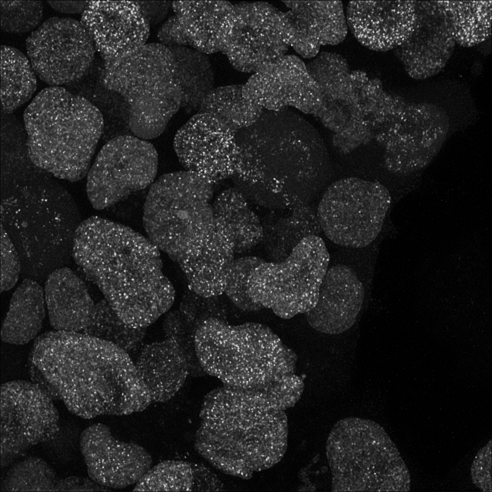
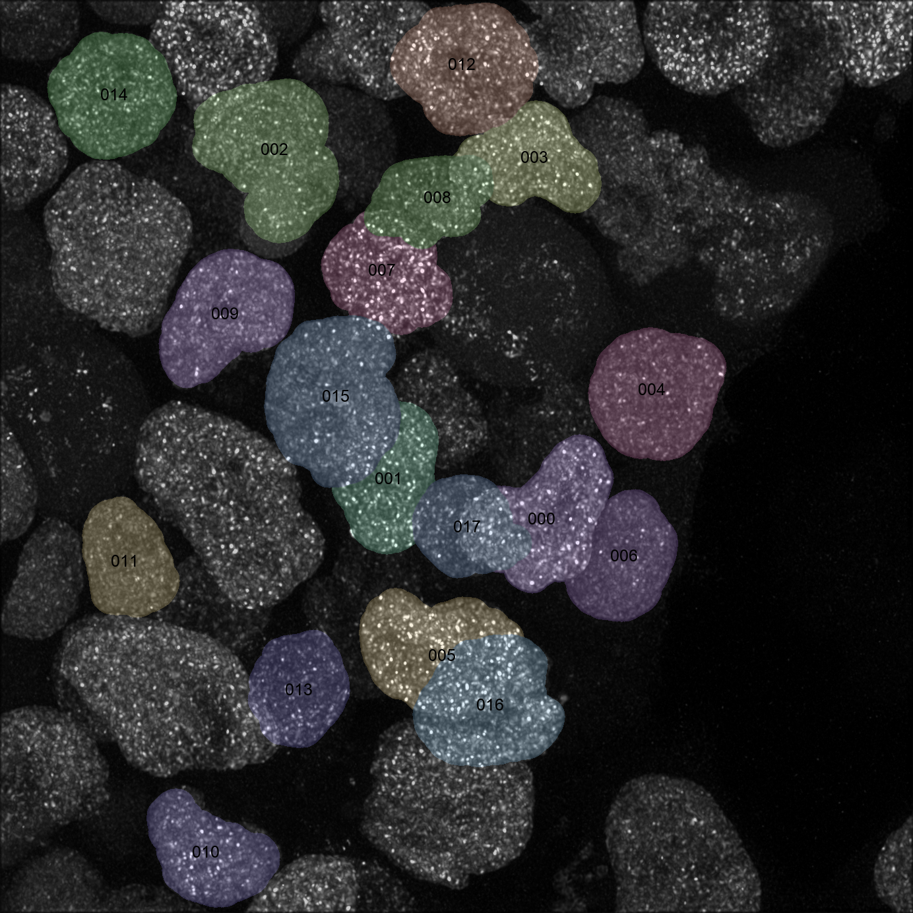
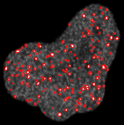

# AiryProcessing

AiryProcessing is a library for processing Airyscan data using CPU/GPU parallelization with an emphasis on particle segmentation to measure particles (such as membraneless compartments) within nuclei. This library was made by modifying Fyrtarn, which is a lattice lightsheet processing library (https://github.com/ahansenlab/Fyrtarn). The framework used in Fyrtarn is largely intact, and functions used in Fyrtarn but not in airyscan processing still remain.


This library is written as an editable ```airy_pipeline``` package with scripts for an analysis pipeline and importable functions for tools like deskewing and deconvolution. See ```example/tune_parameters.ipynb``` to explore and tune such methods.


## Installation

### Environment

The library has been tested on Linux system  with ```python``` 3.10 to 3.14. To make an environment using ```conda```, one can use the following commands.
```
conda create --name airy_processing python=3.14
conda activate airy_processing
```

### Get the library
The following blocks with will walk through the library installation. 
```bash
git clone git@github.com:ahansenlab/Polycomb_body_image_processing.git AiryProcessing
cd AiryProcessing
```

### Install the library
It is best to install the library as the editable ```airy_pipeline``` package to run, evalute, and modify each of the modules for a specific project. 

```bash
mkdir .install  # hide the build here
```

```bash
pip install -e .[CUDA]  # see below
```

Support for (NVIDIA) GPUs is enabled through CuPy. In order to work properly, this dependency must be configured to the CUDA Toolkit version. For example, an environment with CUDA 12.9 would use the following.
```bash
pip install -e .[12]
```

Use ```nvcc --version``` if you are unsure which CUDA is available. Should issues with CuPy persist, you may need to set your environment variables such that CuPy can see CUDA. See [here](https://docs.nvidia.com/cuda/cuda-installation-guide-linux/#post-installation-actions) for more information.

## Pipeline modules

### How to run

The pipeline is mainly organized into scripts representing a processing module that can be run either within Python or on the command line.

#### Run within Python
```py
from airy_pipeline import module

module.run(file="file.czi", config="airy_config.yaml")
```

#### Run on command-line
```bash
python airy_pipeline/module.py --file file.czi --config airy_config.yaml
```

#### All options
Note that not every option will be used by a module.
| Keyword (--flag)             | Description                  |
| ---------------------------- | ---------------------------- |
| file (--file / -f)           | Input (CZI) file             |
| beads (--beads / -b)         | Path to (TXT) file of beads  |
| psf (--psf / -p)             | Point spread function (H5)   |
| directory (--directory / -d) | Path for pipeline outputs    |
| config (--config / -c)       | Path to (YAML) config        |
| start (--start / -s)         | Starting frame               |
| end (--end / -e)             | Ending frame (exclusive)     |
| nproc (--nproc / -n)         | Number of CPU processes      | 
| gpus (--gpus / -g)           | Number of GPU devices        |
| mode (--mode / -m)           | Mode for pipeline module     |
| other (--other / -o)         | Additional input for testing |
| force (--force / -f)         | Ignores overwrite handling   |

### Modules

#### ```beads.py```

**Mode:** ```finding```

Detects beads (in all movies) for intensity measurements and links between channels for chromatic aberration corrections. Can be used to measure PSFs for deconvolution.

**Mode:** ```fitting```

Computes (for a single movie) a PSF for laser intensity corrections and fits a low-order polynomial to channel offsets for applying chromatic aberration corrections.

#### ```segmentation.py```

Reads and deconvolves each frame then finds nuclei. Nuclei are segmented through a series of filters then bounding boxes (and masks) are saved for all nuclei.




#### ```detection.py```

This detects features (dots) within all tracked nuclei using a range of Laplacian of Gaussian (LoG) filters for size selection. This module is not needed for nuclear particle segmentation.


#### ```tracking.py```

**Mode:** ```nuclei```

Tracks nuclei based on centroid positions throughout all segmented frames. For single frame (snapshots), this module is not needed.


**Mode:** ```features```

Links detected features within a nucleus to make tracks of feature positions across channels. For single frame (snapshots), this module is not needed.


#### ```measuring.py```

This module is intended to measure and quantify tracked features within each nucleus. Currently, it is configured to measure Polycomb bodies within each nucleus. 



#### ```movies.py```

Makes movies of pipeline outputs across multiple modes.

**Mode:** ```labels```

Shows all tracked nuclei on a maximum intensity projection (MIP) of the segmentation channel.


**Mode:** ```channels```

Makes a MIP of the signal in tracked nuclei for all channels (including a merge). This is not needed for single channels.


**Mode:** ```nuclei```

For each tracked nucleus, makes MIPs along each axis and channel.


**Mode:** ```evaluate```

Same as above but adds a trace over every tracked feature. This is not needed for Polycomb body segmentation.


### Quality Control

After running the pipeline modules, use "check_segmentation.ipynb" to output a .png of all nuclei from an image. A separate document containing a list of any nuclei to exclude based on erroneous nuclear segmentation can then be used to exclude these nuclei from the final output.

